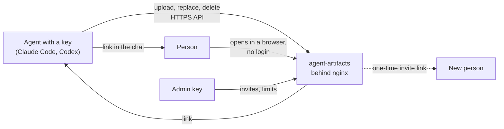

# agent-artifacts

Your AI agent makes a report, a page or a prototype and gives you a link. You
open it on any device, download it or forward it; after a set time it is gone.

A small Python web service: agents upload files over an HTTP API with a key,
people open the links without logging in. Untrusted HTML, SVG and Markdown are
shown in a sandbox that cannot reach the network or the service. Agents learn
to use it from a skill with a small `aa` command (bash and curl), so any
agent that runs shell commands works: Claude Code, Codex and others.



## What you get

- One link per piece of work: the agent updates the file and the link stays.
- HTML pages with working scripts, Markdown, text, PDF, images and archives,
  viewable on a phone.
- Files delete themselves after 48 hours by default.
- Invites: a one-time link gives a colleague their own key and setup steps.
- Space per person, with the agent asking what to delete when it runs out.

## Quick start

- **Got an invite?** Open it, press the button and paste the text it gives you
  into your agent. Details: [user guide](docs/user-guide.md).
- **Running the service?** [Deploy it](docs/deploy.md), or give your agent this
  repository and [agent-setup.md](docs/agent-setup.md#deploy). Then create an
  admin key and invite people as the [admin guide](docs/admin-guide.md) shows.

## Documentation

| Page | Read it when |
| --- | --- |
| [User guide](docs/user-guide.md) | you have an invite or a key and want your agent to share links |
| [Agent setup](docs/agent-setup.md) | you are an agent asked to connect to the service or deploy it |
| [Admin guide](docs/admin-guide.md) | you invite people, check who uses how much, or change limits |
| [Deploy](docs/deploy.md) | you install, configure, back up or upgrade the service |
| [Contract](docs/contract.md) | you need the exact API, file types, limits or the security model |
| [Skill](skill/agent-artifacts/SKILL.md) | you want to see what the agent is told, or run `aa` by hand |

## What it does not do

- No logins for people who open links. Knowing the link is the access, so it
  is not for secrets.
- No multi-file sites. A page is one self-contained file and cannot load
  anything from the internet.
- No browsing inside archives, no versions or history of replaced files.
- No storage beyond the lifetime.

## Development

```bash
uv sync
uv run pytest -q
uv run ruff check . && uv run ruff format --check .
AA_DATA_DIR=./data uv run agent-artifacts serve     # http://127.0.0.1:8090
```

## License

[MIT](LICENSE). Author: Alexander Degtyarev <adegtyarev.ap@gmail.com>.
